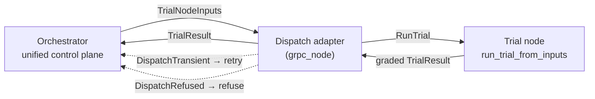

# Detached execution — running a trial somewhere else

This document explains how tolokaforge runs a trial on a machine other than the
one the orchestrator runs on, and how that stays an opt-in choice that leaves the
single-box experience exactly as it is.

## The mental model

Start with one idea: **a trial is a self-contained unit of work.** Everything a
trial needs is described by data — which task, which models, which grader, the
conductor and runtime to use, and a fingerprint of the task files — plus a mounted
copy of those files. Given that data, `run_trial_from_inputs(inputs) -> TrialResult`
runs the whole trial and returns a graded result, with no orchestrator in the
process.

Two separate decisions sit on top of that unit, and they are independent:

- **The orchestrator decides _what_ runs.** It reads the run config, picks the
  trials, hands each one out, collects the results, and writes the report. It is a
  lean control plane — the unified interface to operate the system.
- **A dispatch adapter decides _where and how a trial is sent to run._** It takes
  one trial's inputs and returns its graded result. The orchestrator does not care
  how the adapter does that.
- **The substrate decides _how the sandbox itself is built._** This is the
  single-box runtime backend — the Docker stack a trial runs against.

"Where a trial is sent" (dispatch) and "how its sandbox is built" (substrate) are
two different axes. You choose one on each axis, and the choices do not constrain
each other.

## The two axes

**Dispatch adapters** answer "where does this trial run?"

- `local` runs each whole trial on the machine the orchestrator runs on — in a
  thread pool, or on local worker processes it spawns itself (described below).
  It needs no external dispatch service.
- `grpc_node` ships each whole trial to a trial node on another machine (described
  below).
- The adapter contract is open. An external distributed backend fits the same
  seam without changing the orchestrator.

**Substrate backends** answer "how is the sandbox built?" — these are the
single-box runtime backends:

- `shared` (the default) — one Docker stack for the whole run.
- `per_trial` — a fresh stack for every trial, for tasks whose services must reset
  between trials.
- `in_memory` — a test double, no Docker.

When no dispatch adapter is set, the run picks a substrate backend and runs on the
same machine. This is what `pip install` plus one command gives you, and it is
unchanged. When a dispatch adapter _is_ set, the orchestrator builds no local
substrate — the node that runs the trial builds its own.

See [RUNTIME_BACKENDS.md](RUNTIME_BACKENDS.md) for the substrate backends in full.

## Selecting a dispatch adapter

One config block, `orchestrator.dispatch`, names the adapter and its options:

```yaml
orchestrator:
  auto_start_services: false
  dispatch:
    adapter: grpc_node
    config:
      nodes: ["10.0.0.5:50061", "10.0.0.6:50061"]
      lease_timeout_s: 300
```

- `adapter` is a name registered in the `tolokaforge.dispatch_adapters`
  entry-point group. `local` and `grpc_node` ship in-tree.
- `config` is the adapter's own options block; each adapter defines and validates
  its own shape.
- Leave the whole block out and the run takes the single-box substrate path,
  unchanged.

## How `local` runs a trial

The `local` adapter runs every trial on the machine the orchestrator runs on. It
needs no external dispatch service, so it is both the native dispatch path and
the way to exercise the dispatch seam end to end on one machine. It has two
modes, chosen by `config.mode`:

```yaml
orchestrator:
  auto_start_services: false
  dispatch:
    adapter: local
    config:
      mode: subprocess
      workers: 2
```

- `thread` (the default) runs each trial in-process on a thread pool of
  `config.workers` threads. It spawns no process and opens no socket; it runs the
  same whole-trial entry a node runs, on a JSON copy of the inputs.
- `subprocess` spawns `config.workers` local trial-node worker processes, each on
  its own loopback port, and dispatches to them over `RunTrial` exactly as
  `grpc_node` does — only the placement differs. The adapter spawns the workers
  when it connects and tears them down when it closes.

`config.workers` is the trial concurrency in both modes. Both run the identical
trial unit, so a run reads the same whichever mode it picks.

`orchestrator.runtime: remote` (and `--runtime remote`) is a one-release
deprecated alias for `dispatch.adapter: grpc_node`, taking its node list from
`orchestrator.remote.nodes`. It emits a `DeprecationWarning`; set the `dispatch`
block instead.

## How `grpc_node` runs a trial

The `grpc_node` adapter leases one trial node per trial from a node registry
(seeded from `config.nodes`), ships the trial's inputs to it over a single
`RunTrial` call, and releases the lease whatever the outcome. The node runs the
conductor, the agent loop, the grader, and its own sandbox; the control plane
ships the inputs once and receives a graded result once. Each node serves one
trial at a time, so the number of nodes bounds how many trials run at once.



Two rules make this safe:

- **Credentials never travel in the inputs.** Model configs carry
  `${secret:NAME}` references; the node resolves them from its own secret payload.
- **A drifted pack is refused, not graded.** The node checks the mounted task
  files against the fingerprint in the inputs, so a wrong or edited pack fails loud
  instead of being graded silently.

### Failures use a transport-neutral vocabulary

Every adapter reports failures with three exceptions that name no transport
(`tolokaforge/core/dispatch/errors.py`):

- `DispatchRefused` — a deterministic refusal (bad config, version skew, missing
  secret, drifted pack). The orchestrator does **not** retry it; the trial becomes
  a `PROVISION_ERROR` result with a failure bundle.
- `DispatchProvisionError` — the sandbox could not come up. Treated the same way:
  a non-retryable `PROVISION_ERROR`.
- `DispatchTransient` — an infrastructure fault (a node unreachable, busy, or
  failed internally). The orchestrator **retries** it.

`grpc_node` translates every node-side failure into this vocabulary before it
crosses the seam, so the orchestrator's retry logic never has to know about nodes.

## Limits today

`grpc_node` refuses a run it cannot serve **at run start**, naming the reason,
rather than degrading mid-run. The node runs the native adapter without
coding-harness mode, grades in-process, and hosts a single-stack sandbox whose
compose file lives in the task's own directory. Run anything outside that under a
single-box substrate backend. [RUNTIME_BACKENDS.md § Dispatch adapters](RUNTIME_BACKENDS.md#dispatch-adapters)
lists every refused shape, and [TRIAL_NODE_SERVICE.md](TRIAL_NODE_SERVICE.md)
describes the node service and its contract.

Other current boundaries:

- **One trial per node process.** The process secret manager is global, so a node
  runs one trial at a time; concurrency is bounded by the number of nodes.
- **The agent's LLM loop runs node-side.** Rate-limiting, token accounting, and
  cost happen where the trial runs.
- **The control-plane bundle is reduced.** The control plane writes
  `trajectory.yaml`, `tool_log.yaml`, `metrics.yaml`, and `grade.yaml` from the
  returned trajectory; the node keeps a fuller bundle. A configured tracing
  exporter logs a warning, since the node emits no live traces.
- **Nodes are pre-provisioned.** A node needs Docker and the engine's base images
  present; it builds none itself.

## The ADRs

- **[ADR-0064](adr/0064-dispatch-adapter-seam.md)** — the dispatch adapter seam:
  the `DispatchAdapter` Protocol, the `orchestrator.dispatch` config, the
  `tolokaforge.dispatch_adapters` entry-point group, and the neutral error
  vocabulary.
- **[ADR-0063](adr/0063-whole-trial-node-service-and-dispatch-seam.md)** — the node
  owns the whole trial: the trial-node service and the `RunTrial` contract.
- **[ADR-0059](adr/0059-remote-runtime-backend.md)** — the node registry and the
  run-start gating.
- **[ADR-0058](adr/0058-detached-execution.md)** — separating the control work
  from the execution of one trial; the single-box path stays the default.
- **[ADR-0057](adr/0057-node-runnable-trial-unit.md)** — the portable trial unit:
  the `TrialNodeInputs` contract and the standalone entry.
