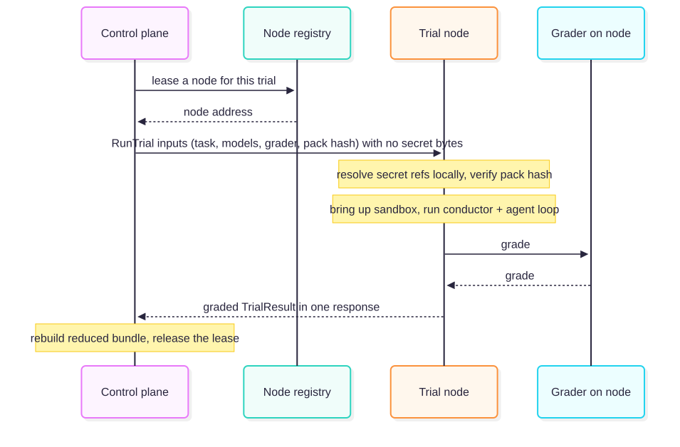

# Detached execution — design overview

> **Status: proposal under discussion.** This document and the ADRs it links are a
> design for review. The decisions are captured as [ADR-0057](adr/0057-node-runnable-trial-unit.md),
> [ADR-0058](adr/0058-detached-execution.md), [ADR-0059](adr/0059-remote-runtime-backend.md)
> and [ADR-0063](adr/0063-whole-trial-node-service-and-dispatch-seam.md). Implementation is in
> progress on separate PRs; **none of it is on `main` yet**. The sections below separate
> **what the engine does today** from **what we propose to change**.

## TL;DR

Today one process — the **orchestrator** — does everything for a whole batch: it decides
what to run, runs each agent's loop, drives the sandbox, grades, and writes the report. To
use more machines you run more orchestrators. You cannot run a single trial without the whole
orchestrator, and the runner and grader cannot stand on their own.

We propose to **split the "brain" (deciding and collecting) from the "hands" (running one
trial)**, and make "run one trial" a self-contained, portable unit. One control plane can then
hand trials to many simple execution nodes on other machines. **The single-box experience stays
the default and is byte-for-byte unchanged** — detaching is opt-in.

---

## 1. Current state (what `main` does today)

A single orchestrator process welds together two different jobs:

1. **The brain (control):** read the run config, choose trials, hand out work, collect results,
   write the report.
2. **The hands (execution):** run *one* trial — stand up its sandbox, drive the agent↔user loop,
   call the LLM, execute tool calls against the runner, grade it.

Because the two are welded together:

- **Scaling means cloning the whole brain.** More machines = more `tolokaforge worker` processes,
  and *every worker is a complete orchestrator*. Fine on one laptop; the wrong shape for a managed
  service where one brain should feed many simple, interchangeable hands.
- **You cannot run just one trial** without dragging the whole orchestrator along — the conductor and
  the agent↔user loop live in the orchestrator process.

**What is already separable today** (so this work does *not* re-do it): the **runner** already runs as a
standalone service and published image with no orchestrator (the orchestrator is just one of its clients),
and the **grader** is already detachable — as a service (`grader_rpc`), a pool of queue workers (`queue`),
or fully **offline**, grading from a persisted grade bundle with no live runner (`tolokaforge grade` /
`grade-run`). The coupling this work removes is the **control loop** — the orchestrator being both brain
and hands — not the runner or the grader, which already stand on their own.

This single-box behaviour is what `pip install` + one command gives today, and the proposal keeps it
exactly as-is.

---

## 2. Why change — the goal

The end state is a **managed service**: **one control plane that dispatches heterogeneous jobs
(our native agent loop and delegated harnesses alike) across many machines**, instead of many full
orchestrators each doing everything. "Many orchestrators sharing a queue" already works for
distributed batches, but it is *many brains*, not one managed control plane, and it still cannot run
a single trial standalone.

---

## 3. The proposal (target architecture)

**Separate the brain from the hands, and make "run one trial" a portable unit.** One control plane
leases a node per trial and ships the whole trial to it; the node runs it and returns a graded result.

Four load-bearing ideas:

1. **A trial is a portable unit** described entirely by **data** (which task, which models, which
   grader, plus a fingerprint of the task files) with a mounted copy of those files — no orchestrator
   required. *(ADR-0057)*
2. **Every trial runs through one narrow seam.** Native agent loop or delegated harness, to the hands
   it is "run this one trial." The execution side does not care what kind of trial it is. *(ADR-0058)*
3. **The node owns the whole trial.** The conductor, the agent loop, the sandbox and the grader all
   run on the node; the control plane ships inputs once and receives a graded result once. *(ADR-0063,
   evolving ADR-0059)*
4. **The grader is already a separable component** — a service, a queue of workers, or fully offline from a
   grade bundle (existing work). The node reuses the in-process grading seam; whether whole-trial remote
   should also compose with the *standalone* grader service is an open question (§9). *(ADR-0038/0040/0043,
   ADR-0058)*

---

## 4. How it works (the mechanisms)

### 4.1 The portable trial unit — ADR-0057

A trial's composition (grader + conductor + executor) is built in **one place**,
`build_trial_execution_unit(...)`, called by both the orchestrator and a standalone entry. The input
contract, `TrialNodeInputs`, is pure data — the task config, the trial spec, the grader config, the
runtime/conductor names, and the task pack's **content hash**. A standalone entry,
`run_trial_from_inputs(inputs) -> TrialResult`, runs one trial with **no orchestrator in the process**.

- **Credentials never travel in the inputs.** Model configs carry `${secret:NAME}` references; the node
  resolves them from its own secret payload.
- **Fail loud on a drifted pack.** The node verifies the mounted task files against the hash, so a wrong
  or edited pack is refused instead of silently graded.

### 4.2 One dispatch seam — ADR-0058

Native and delegated trials converge on the same path, so the hands need no per-kind logic.

### 4.3 Remote backend + node registry — ADR-0059

A `remote` runtime backend leases a node per trial from a **node registry** (a Protocol; the first
implementation is config-seeded and in-process), instead of starting a local sandbox. The node count
bounds concurrency: asking for a node when none is free waits rather than double-booking. A run shape
the backend cannot serve is **refused at run start**, not degraded mid-run.

**Where `remote` sits among the runtime modes.** The runtime is chosen by `orchestrator.runtime`. Today's
modes are all *local* — they stand the sandbox up on the same machine: **`shared`** (the default — one
compose stack for the whole run), **`per_trial`** (a fresh stack per trial, for tasks whose services must
reset between trials), and **`in_memory`** (a test double). `remote` is the new mode: it stands up no local
stack and instead leases a node and dispatches the trial there. A single-stack
`environment_manifest` in the task's own directory also runs on the node, which materialises it once for
its trial; multi-stack, `reset`-service and project-level compose stay with `shared` / `per_trial` (§7).

### 4.4 The node owns the whole trial — ADR-0063

ADR-0059's first cut kept the agent loop on the control plane and sent each tool call over the network
to the node's runner — a network round trip inside every agent turn, and a long, chatty connection.
ADR-0063 moves the whole trial onto the node: a dedicated **trial-node service** (sibling of the runner
and grader services, with its own versioned contract) hosts `run_trial_from_inputs`. The control plane
ships the inputs once over a single `RunTrial` call and receives a graded result once.

---

## 5. Current state vs proposal — at a glance

| Dimension | Today (`main`) | Proposed |
|---|---|---|
| Use more machines | Run many full orchestrators (`worker`) | One control plane, many thin execution nodes |
| Run a single trial | Not possible without the orchestrator | A standalone, portable unit — with or without the orchestrator |
| Where the agent loop runs | In the orchestrator process | On the node that owns the trial |
| Native vs delegated harness | Separate handling | One dispatch seam — the hands do not tell them apart |
| Grader | **Already detachable** — a service (`grader_rpc`), a queue of workers, or offline from a grade bundle | Unchanged; the remote node grades **in-process** (composing with the standalone grader is an open question) |
| Single-box experience | The only mode | **The default, byte-for-byte unchanged** (detaching is opt-in) |

---

## 6. What ships in which step

Delivered as a stack of small PRs; the single-box path is locked byte-for-byte by test at every step.

| Step | What it adds | State |
|---|---|---|
| 1 | The portable trial unit + standalone entry; delegated harnesses node-runnable | Done (on the integration branch) |
| 2 | `remote` backend + node registry — lease a node per trial | Done (merged to the integration branch) |
| 3 | The node owns the whole trial — trial-node service + dispatch seam | In progress (3a merged; 3b–3e planned) |
| 4 | Reshape `worker` into a thin node; the orchestrator becomes control-plane-only | Planned |
| 5 | One control plane dispatching **native + delegated** trials across nodes | Planned (needs the multi-harness heterogeneity layer) |

---

## 7. Implications & trade-offs

- **The agent's LLM loop moves node-side.** Rate-limiting, token accounting and cost happen where the
  trial runs. This is the point of "the node owns the trial," but it changes where those controls live.
- **One trial per node process.** The process secret manager is global, so a node runs one trial at a
  time (concurrency is bounded by the number of nodes). This keeps secret handling simple and isolated.
- **Reduced control-plane bundle, for now.** The control plane rebuilds a bundle from the returned
  trajectory; the node keeps a fuller bundle locally. Live tracing for node-run trials is not wired yet.
- **Whole-trial remote does not yet use the detached grader.** Grading already runs detached today (a
  service, a queue, or offline from a bundle), but the remote node grades **in-process** against its
  co-located runner — `grader_rpc`, `queue`, and offline/snapshot-bundle grading are all *refused* under
  `remote`. "Detached grader" and "detached whole-trial execution" are two separate mechanisms that do not
  compose yet.
- **Multi-container on the node is single-stack only.** A task whose `environment_manifest` declares one
  stack, no `reset` service and a compose file inside its own directory runs on the node; multi-stack,
  `reset` (seeds are not shipped) and project-level compose are refused under `remote` and run under
  `shared` / `per_trial`. A task with no manifest uses the built-in single-runner (or runner + db) stack
  against the node's co-located runner.
- **Nodes must be pre-provisioned.** A node needs Docker and the engine's base images present; it builds
  none itself.
- **One unary call per trial, for now.** No streaming progress and no mid-trial cancellation yet; a
  cancelled run cannot stop a trial already on a node. Node liveness surfaces via keepalive.
- **Retry semantics are explicit.** A deterministic refusal (bad config, version skew, missing secret,
  drifted pack) is **not** retried; an infrastructure fault is.
- **A trust seam between brain and hands.** In single-box they share one process, so the separation only
  matters once they are truly split — the design keeps that seam intact for when they are.

---

## 8. Explicitly out of scope (later milestones)

- A **job-submission service / multi-user front door** (the managed-service control API).
- **Cloud backends** (Kubernetes / Modal / microVM) — the seam is designed for them; they are not built.
- Moving warm pools / autoscaling / the open agent loop.

---

## 9. Open questions for discussion

1. **Selecting `remote`.** It currently rides the deprecated `orchestrator.runtime` knob; a dedicated,
   non-deprecated selector is a follow-up. What should it look like?
2. **Observability for node-run trials.** Live traces are absent for now. Do we stream them back, ship
   the node's bundle, or expose node-side tracing?
3. **How self-contained should a node be?** The base case dials a co-located runner; only task-declared
   per-trial stacks are fully self-contained on the node. Is "co-located runner" acceptable long-term, or
   should every node be fully self-contained?
4. **Streaming + cancellation priority.** How important is mid-trial progress/cancel vs the simpler unary
   call, given trials can run minutes to hours?
5. **The brain↔hands trust model.** What is the authn/authz and network trust story once nodes live on
   other machines (and eventually other tenants)?
6. **Should whole-trial remote compose with the detached grader?** Today the node grades in-process and
   refuses the standalone grader service, the queue, and offline bundles. Do we want a remote trial to be
   gradeable by the separate grader service or to emit an offline bundle, or is node-local grading the model?

---

## 10. The ADRs

- **[ADR-0058](adr/0058-detached-execution.md)** — the keystone: separate the brain from the hands;
  the portable trial unit; single-box stays the default.
- **[ADR-0057](adr/0057-node-runnable-trial-unit.md)** — the mechanism: one composition, the
  `TrialNodeInputs` contract, the standalone entry, the adapter seam.
- **[ADR-0059](adr/0059-remote-runtime-backend.md)** — the remote backend and node registry (its
  per-trial RPC dispatch is superseded by ADR-0063; the registry and run-start gating stand).
- **[ADR-0063](adr/0063-whole-trial-node-service-and-dispatch-seam.md)** — the node owns the whole trial:
  the trial-node service, the `RunTrial` contract, and the dispatch seam.
