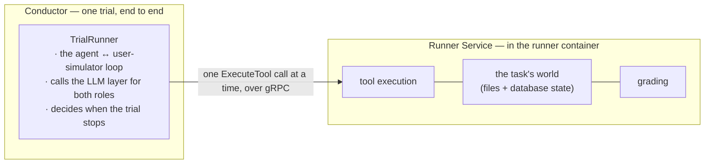
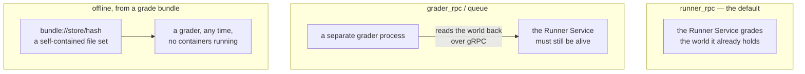
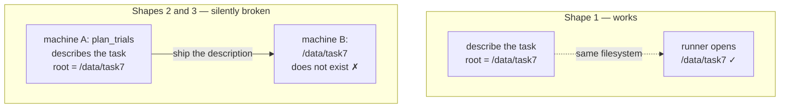
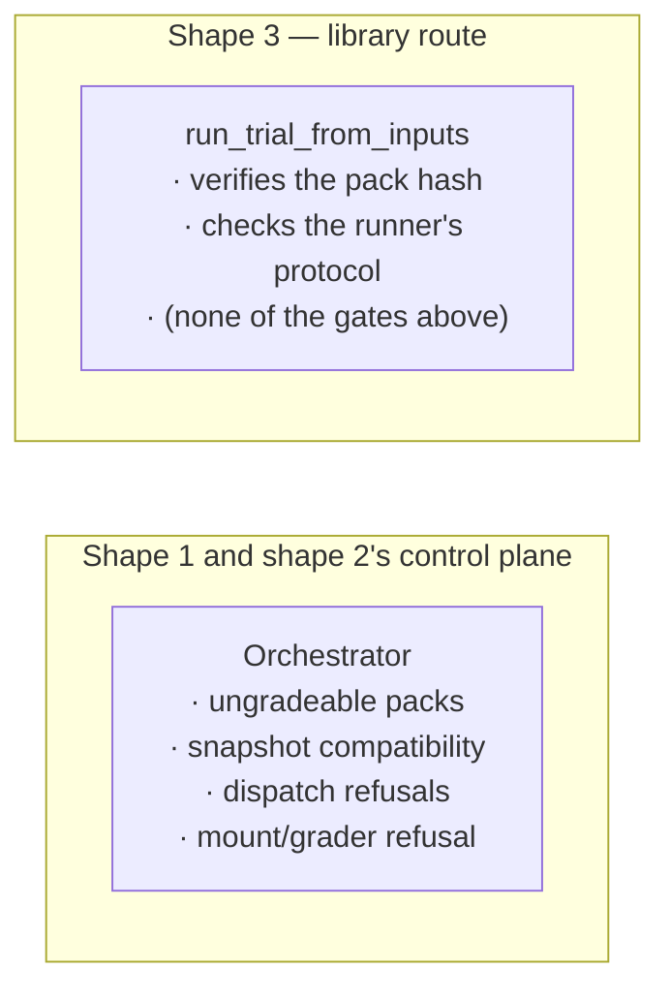
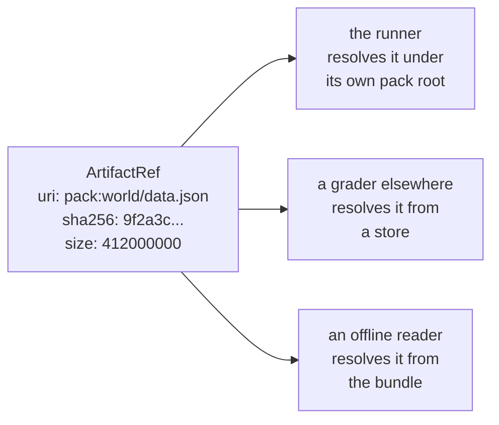

# 0072. A trial's bulk data is addressed by content and resolved where it is consumed

- **Status:** Proposed
- **Date:** 2026-11-06
- **Deciders:** @CiroGamboa, @rsmtnn
- **Supersedes:** —
- **Superseded by:** —

> Numbers 0068-0071 belong to four ADRs open on the branches of #1970, #1972,
> #1977 and #1978. This one takes the next free number. It **supersedes none of
> them** — see § What this means for the open work.

## TL;DR

A trial's bulk data reaches whoever needs it six ways. **Three of them already
work when the trial runs on another machine** — the task pack, compose files and
grade bundles are each named by content and resolved wherever they are read.
**Three do not** — a task's files, its initial state and its final state travel as
bytes inside a gRPC message, which is why a large world cannot run in a 24 GiB
sandbox.

ADR-0068/0069/0071 fix that, and this ADR keeps their mechanism whole. What it
changes is the *name*: those ADRs call the destination `mount`, meaning "a
filesystem both sides share". That holds when everything runs on one box, and
silently breaks in the other two ways tolokaforge can be driven, where the task is
described on one machine and the trial runs on another. It is also why remote and
offline grading have to be refused for exactly the large tasks that motivated the
work.

Instead: one `ArtifactRef {uri, sha256, size}` for all three directions, with the
scheme saying how to resolve it; a resolver seam copied from the `BundleStore` that
already works; how bytes travel as a deployment choice rather than a task field;
and the validation rules written on the trial contract so every entry point
enforces them.

One change then serves grading in the runner, grading in a separate process,
grading offline from a bundle, an external orchestrator driving us, and a future
substrate — instead of each needing its own answer, and three of them being
refused.

**How to read this.** The first half explains how tolokaforge runs today, in plain
terms and with pictures. You need that picture to see why the problem is a problem.
The second half proposes a change. If you already know the architecture, skip to
§ The problem.

---

## Context and Problem Statement

### What runs where during one trial

Three names do the work, and they are not interchangeable:

```
Orchestrator        the batch — schedules trials, owns the attempt queue,
                    retries, aggregates results. Not part of a single trial.
  └─ Conductor      one trial, end to end — environment setup, RegisterTrial,
                    the loop, grading, writing artifacts.
       └─ TrialRunner   the agent ↔ user-simulator loop. Calls the LLM layer for
                        both roles and dispatches each tool call as ExecuteTool.
```

Everything that touches the task's world lives on the other side of a gRPC call,
in the **Runner Service** inside the runner container.



Two things about this surprise people:

- **The model calls do not happen in the runner container.** The TrialRunner talks
  to OpenAI/Anthropic/etc. from wherever the Conductor is running. Only tool calls
  cross into the Runner Service.
- **Grading happens in the Runner Service** (`GradeTrial`), not in the Conductor.
  The Runner Service has the world, so it diffs the state and runs the checks
  locally. Nothing on the Conductor's side needs the final state during a run.

That second point matters later: the world and the grader are naturally in the same
place.

### Three ways to run tolokaforge

The Conductor can live in three different places. This is the one choice that
decides everything else. We call them **integration shapes** (`ARCHITECTURE.md` §7).

```mermaid
flowchart TB
    subgraph S1["Shape 1 — single box: tolokaforge run"]
        direction LR
        O1["Orchestrator<br/>└ Conductor<br/>&nbsp;&nbsp;&nbsp;└ TrialRunner"] -->|gRPC| R1["Runner<br/>Service"]
    end
    subgraph S2["Shape 2 — dispatched: orchestrator.dispatch"]
        direction LR
        O2["Orchestrator<br/>(the batch only)"] -->|"ships the whole trial"| N2["trial node:<br/>Conductor + TrialRunner<br/>+ grader + its own stack"]
        N2 -->|gRPC| R2["Runner<br/>Service"]
    end
    subgraph S3["Shape 3 — library route: an external orchestrator"]
        direction LR
        O3["YOUR orchestrator<br/>(any external scheduler)"] -->|"plan_trials<br/>run_trial_from_inputs"| N3["Conductor + TrialRunner<br/>+ grader + its own stack"]
        N3 -->|gRPC| R3["Runner<br/>Service"]
    end
```



| | Who owns the run loop | Where the Conductor runs | Where the TrialRunner runs |
|---|---|---|---|
| **Shape 1** | tolokaforge `Orchestrator` | orchestrator process | orchestrator process |
| **Shape 2** | tolokaforge `Orchestrator` | the trial node | the trial node |
| **Shape 3** | **your** orchestrator | wherever you call step 2 | wherever you call step 2 |

Notes worth knowing:

- The Conductor and its TrialRunner are never in different places: the Conductor's
  job is one whole trial, so it travels with the trial.
- In shape 2 the orchestrator keeps only scheduling, retries and aggregation. The
  node builds its own Docker stack.
- In shape 3 there is **no tolokaforge `Orchestrator` at all**. You call three
  functions: `plan_trials(cfg)` turns a run into one `TrialNodeInputs` per trial,
  `run_trial_from_inputs(i)` runs one anywhere, `aggregate_results(...)` folds the
  results into the usual report. `tolokaforge run-trial --inputs file.json` is the
  command-line form, meant for a sandbox you cannot open a connection into — you
  write the inputs in, run it, read the result out.
- Shape 3 is the shape an external orchestrator is meant to drive us through.

### Where grading can happen, and why it matters

Grading is a separate axis from the shapes above: in principle any shape can use
any of these.

**Why you would want the grader off the runner.** Running a trial and grading it
are different kinds of work, and tying them together costs us several things:

- **Re-grading without re-running.** A trial costs agent tokens and minutes. A
  grade costs a judge call. If the grade fails — a judge timeout, a provider error
  — and grading only exists inside the trial, the whole trial is wasted. If the
  trial's inputs are durable, the grade is a cheap retry.
- **Changing your mind later.** A new rubric, a different judge model, a fixed
  check — all of these want to re-score runs that already happened, without paying
  for them again. The `judge-kind-ab` tool already does exactly this, over stored
  bundles.
- **Scaling the two independently.** Running a trial is Docker- and
  memory-heavy. Grading is LLM-heavy and bursty. They want different concurrency
  limits and different machines.
- **Not holding the world open while a judge thinks.** With grading inside the
  runner, the whole stack — runner, database service, any task services — stays up
  for the duration of a judge call.
- **Plugging in a different grader** without touching the thing that runs trials.
- **Failure isolation**: a crashing grader should not take a trial with it.



**Where each mode stands today.**

| Mode | What it does | Status |
|---|---|---|
| `runner_rpc` | the Runner Service grades its own world | **The default, and solid.** Nothing to resolve, nothing to ship over a wire. Keeps the whole stack alive for the judge call. |
| `judge_only` | a judge scores the transcript; reads no world at all | **Works.** Needs the task's `llm_judge` block and a run-level judge model. |
| `grader_rpc` | a separate grader process (`tolokaforge/grader/`, port 50052, stateless per call) | **Partly there.** The process is detached, the data is not — it calls back into the Runner Service. Needs `expose_substrate: true`, and hash grading is refused. In practice it is not even host-detached: `ctx.grader_address` is populated by nothing in-tree, so every run dials the *runner's* address. |
| `queue` | the same, with N workers pulling jobs from a broker | **Reference only.** `InMemoryGradeBroker` is a `queue.Queue` plus a per-trial future, and the workers are daemon threads *in the same process*. The Protocol is there for Redis/RabbitMQ/SQS; no such backend exists yet, so there is no cross-host grading pool. |
| offline, from a bundle | grade from a content-addressed file set, no containers | **The real detachment, and the most complete.** Bundle format v1.1, `BundleStore` with local-disk and S3, consumed by `tolokaforge grade`, offline recompute, the A/B tool and the CI parity lanes. But the grader service cannot be *handed* one: `bundle_manifest_json` and `bundle_parts_uri` (fields 13 and 14) are reserved and populated by nothing. And some checks cannot run offline at all — `db_probe` raises, `knowledge_search` returns nothing, hash grading and `run_test_suite` are refused. |

Two more substrates are reserved and raise `NotImplementedError` today:
`SharedMountGradingSubstrate` (grader and runner as sibling containers over a
shared volume — single host) and `TrajectoryStorageGradingSubstrate` (grading from
a trace store). ADR-0040 holds both recipes.

And a detail that shapes everything below: **all three non-runner modes are refused
under dispatch.** `_refuse_unsupported_dispatch_run` turns down `grader_rpc`,
`queue` and `grader.snapshot.enabled`, because the node grades in-process and
produces no control-plane bundle. So today, the moment a trial is dispatched, the
only grading mode available is the one that keeps the grader next to the world.

So "detached grading" means two different things. `grader_rpc` detaches the
**process** but not the **data** — it calls back into the Runner Service. Only the
bundle detaches both. That distinction is the whole reason this ADR is about
*addressing*: a grader can only be moved as far as it can still reach the bytes.

### How a trial's data gets where it is needed

This is the part the ADR is about. A trial needs bulk data in several places, and
today each kind travels differently:

| What | How it is named | Does it survive being shipped to another machine? |
|---|---|---|
| The task pack | a directory, plus `task_pack_hash` to verify it | **Yes** — it is pre-staged and hash-checked on arrival |
| Compose files | an absolute path, **rewritten** onto the node's own pack root | **Yes** — `_ComposePathRebase` does the rewriting |
| Grade bundles | `bundle://<store>/<sha256>`, moved by a pluggable store | **Yes** — local-disk and S3 stores both ship |
| A task's files | base64 text inside the registration message | No — bytes in a message |
| The initial state | parsed tables inside the registration message | No — bytes in a message |
| The final state | one JSON string in one `GetState` reply | No — bytes in a message |

Read the right-hand column. **Three of these already solve the problem, and three
do not.** And the three that work use only two ideas between them:

- **Name it by content, and resolve the location where you are** (task pack,
  compose files).
- **Name it by content, and fetch it from a store** (grade bundles).

Those are the same idea. One assumes the bytes are already nearby; the other goes
and gets them.

---

## The problem

### Problem 1 — the three message-carried paths do not scale

ADR-0068 measured this precisely, and the numbers are not in dispute. One
native-format task with a world of ~6.5k files and a ~490 MB initial state:

- its registration message is **1367 MiB**, against a hard ceiling of 2047 MiB;
- the sending process holds **five to six whole copies** of the world just to send
  it, peaking at 15.1 GiB and getting OOM-killed in a 24 GiB sandbox;
- separately, writing the final state cost the host **6 min 20 s and +7 GiB** — for
  a state no grader reads, because the runner already graded the trial.

ADR-0068, ADR-0069 and ADR-0071 fix exactly this, and **their mechanism is right**:
keep digests in messages, move bytes out of band, verify on arrival. This ADR keeps
all of it.

### Problem 2 — `mount` names a filesystem, not an address

Alongside that mechanism those ADRs add a name for it: four task-manifest fields,
each `inline | mount`, where `mount` means *a bind mount from a filesystem that the
process describing the task and the runner already share*.

That is true in shape 1. It is not true in shapes 2 and 3, because the description
is built in one place and the trial runs in another:



`TrialNodeInputs` is documented as "a self-contained, serializable description of
one trial you can ship to wherever it will run". A `mount` description serializes
perfectly and quietly stops being self-contained. ADR-0068 records the consequence
in its own trade-offs: *"a node that materialises the stack itself must describe the
task from its own copy of the pack."*

The same reason closes grading. A grader on another machine cannot open a path on
the runner's host, so `grader_rpc`, `queue` and snapshot bundles are refused for
these tasks — which removes remote and offline grading for exactly the large tasks
that motivated the work.

### Problem 3 — the rules live in a component two shapes never build

The gates that refuse a bad combination before a trial spends tokens —
`_reject_ungradeable_packs`, `_validate_snapshot_mode_compatibility`,
`_refuse_unsupported_dispatch_run`, and ADR-0068's own
`_refuse_tool_artifact_refs_the_grader_cannot_read` — are all **methods on
`Orchestrator`**.

`run_trial_from_inputs`' docstring: *"no orchestrator, run queue or batch lifecycle
is involved."*



Meanwhile the fields those gates police travel into `TrialNodeInputs`
**automatically**, because `TaskDescription` is embedded in it — the regenerated
`docs/schemas/trial_node_inputs.v2.json` on those branches gains them. So the
contract ships to shape 3 and the enforcement does not. Every capability added this
way widens the gap.

---

## Decision Drivers

- The bytes of a world are not multiplied by the layers between the adapter and the
  runner's disk, and neither process's memory grows with the world. *(ADR-0068,
  kept verbatim.)*
- The consumer uses exactly the bytes the task was described with, or refuses.
  *(ADR-0068, kept verbatim.)*
- One task behaves the same in all three shapes. How bytes travel is a property of
  the deployment, not of the task.
- A trial's description stays self-contained, because two of three shapes ship it.
- Online, remote and offline grading all stay reachable.
- A rule is written once, where every entry point reaches it.
- Reuse the two addressing ideas already in the repo instead of adding a third.

## Considered Options

1. **Per-direction transport flags** — ADR-0068/0069/0071 as drafted: four
   `inline | mount` fields, an absolute host path on the wire, a gate keyed on
   stack scope, and permanent refusals for every grading path but `runner_rpc`.
   Serves shape 1.
2. **Raise the gRPC limit, or compress.** Rejected by ADR-0068, for its reasons:
   every layer still holds a whole copy and the ceiling only moves.
3. **Stream the RPCs.** Rejected by ADR-0068/0069, for their reasons: the host still
   reassembles and parses, and every backend and node gains a streaming surface.
4. **One content address for bulk trial data, resolved where it is consumed**, with
   the rules written on the trial contract. The same mechanism as option 1, named
   differently and enforced in a different place.

## Decision

Adopt **option 4 — one content address for bulk trial data, resolved where it is
consumed, with the rules written on the trial contract** — in four parts.

### D1 — one address type, instead of four delivery flags

```
ArtifactRef { uri, sha256, size }
```

One type for a task's files, its initial state and a trial's final state. The
digest and size are unchanged from ADR-0068/0069/0071 and stay load-bearing. The
**scheme** in `uri` says how to find the bytes:



- `pack:<relative/path>` — relative to the task pack root **on whichever machine
  is reading**. Portable by construction, and it needs nothing new:
  `--task-pack-root` already mounts the pack into the sandbox, and
  `_verify_task_pack` already hash-checks it.
- `file:///absolute/path` — a filesystem both sides share. This is ADR-0068's
  `mount`, kept, as one scheme among several.
- `s3://…` or `bundle://…` — fetched from a store. Only needed when the bytes are
  not in the pack.

No absolute path from the describing machine goes on the wire.

### D2 — one resolver seam, copied from the one that already works

`BundleStore` already does this job for grade bundles. Same shape:

```
class ArtifactStore(Protocol):
    name: str
    def put(self, local_path: Path) -> str: ...   # returns a uri
    def get(self, uri: str, dest: Path) -> Path: ...
    def probe(self) -> None: ...                  # "can I actually serve this?"
    def close(self) -> None: ...
```

Ship two: `PackArtifactStore` (resolve-and-verify under the pack root, no network)
and `MountArtifactStore` (ADR-0068's verified chunked copy, byte- and
speed-identical). `S3ArtifactStore` waits on a measurement — see § Open questions.

Each consumer holds a resolver. One that cannot serve a scheme says so through
`probe()`, which is how `_validate_snapshot_mode_compatibility` already gates
bundle stores: check the config, probe the capability, probe reachability.

### D3 — how bytes travel is a deployment choice, not a task field

Drop `tool_artifacts_delivery`, `final_state_delivery` and
`initial_state_delivery`. A task says *what it is*; the run says *how bytes move*.
This keeps one task comparable across substrates, which is the point of a
benchmark harness.

A delivery flag also does not belong in `_POLICY_REQUEST_FIELDS`, whose own
docstring defines that group as "substrate-neutral (they describe the trial
regardless of substrate)". A field refused on three of four substrate shapes is not
substrate-neutral — and a project-wide default that survives a task replacing its
`stack` makes that task unrunnable through a flag it never set.

### D4 — write the rules on the trial contract, and refuse by capability

Add `validate_trial_inputs(inputs)` and call it from `Orchestrator`,
`run_trial_from_inputs` and `run_trial`. Move the four gates behind it. One rule
set, three shapes, same refusal before any tokens are spent.

Then a grading topology is refused because **its resolver cannot reach the bytes**,
not because of a flag the task set. `GradeRequest.bundle_parts_uri` — field 14, a
`bundle://` URI, reserved since grader wire v3 and populated by nothing — becomes
the grader's address for referenced parts. The grader already receives the whole
`TaskDescription` on field 6, so it has the references today and only lacks a
resolver.

### What this unlocks, scenario by scenario

| Scenario | Resolver | Result |
|---|---|---|
| Grading in the runner (`runner_rpc`) | already local | unchanged, no cost, still the fast path |
| Remote grading (`grader_rpc`, `queue`) | `pack:` or a store | the grader stops calling back into the runner |
| Offline grading (bundles) | `bundle://` parts | the bundle references parts instead of embedding a huge world |
| External orchestrator (shape 3) | `pack:` | `TrialNodeInputs` stays self-contained |
| Dispatch (`grpc_node`, or a third-party adapter) | `pack:` | rebased on arrival, like compose files already are |
| Single box | `file://` | ADR-0068's mount, unchanged |
| A future substrate (container orchestrator, hosted sandbox) | a store | a registration, not a new refusal |

One change, every row.

---

## What this means for the open work

**This ADR supersedes nothing, and is not a verdict on work in flight.**

ADR-0068/0069/0071 supply the mechanism adopted here and the measurements that
justify it — the chunked hashing, the verified copy, the atomic
temp-file-then-rename state write, the streamed db-service seeding, the streamed
`env.yaml`. All kept. What changes is the **addressing** (D1) and **where the rules
live** (D4); `mount` becomes one scheme rather than the only one. Their author
amends or re-scopes them.

Measured on the open branches: of roughly **2,850 production lines** across
#1970/#1972/#1978, about **890 are the wiring that moves** — the manifest fields,
the resolver gate, two `MaterialiseContext` fields, the grader refusals and the
version bumps. The mechanism is not touched.

Three pieces have **no coupling to this ADR at all** and should land on their own
merits, without waiting for it:

- **#1974** — the DB-init timeout fix. Independence verified symbol by symbol
  against `main`, with a hunk-overlap check.
- **#1977 / ADR-0070** — the redundant grading copies. No wire change, documented
  fallbacks to older db-service images. Needs one line when rebased:
  `state_json = json.dumps(state)` in `_get_state_async`.
- **#1972's first commit** (`bfe29023`) — the streamed `env.yaml` writer. Helps
  *every* run, inline included: 167 s / +2019 MiB becomes 18 s / +0 MiB. Verified
  to cherry-pick onto `main` with no conflicts.

## Consequences

### Positive

- The measured gains of ADR-0068/0069/0070/0071 are kept; the mechanism is theirs.
- A trial's description is portable, so dispatch and the library route work without
  re-describing the task on each node.
- Remote and offline grading stay available for large worlds.
- One additive protocol version for the family, instead of one per direction.
- A new substrate is a store registration, not a new refusal.
- `pack:` costs nothing to build — the pack is already mounted and already verified
  inside the sandbox.
- One place to state a validation rule, so the next capability does not widen the
  gap between shapes.

### Negative / Trade-offs

- Rework on code already written and reviewed twice. Most survives as the two
  stores, but the manifest fields, the resolver gate, the `MaterialiseContext`
  fields and the version bumps change, and three ADRs need amending. ~890 lines, as
  measured above — a re-pointing, not a rewrite, but not free either.
- A seam costs something while it has one real implementation.
- Moving the gates touches four existing `Orchestrator` methods and their tests,
  which the data-plane goal does not strictly need.
- `file://` keeps its own limits: a shared filesystem, a directory visible to the
  runner, no remote grader. The seam stops those being the only option; it does not
  remove them.
- Two pre-existing gaps block the extension story, and are nobody's fault:
  `load_compose_materialiser` is called only from tests and
  `DefaultSubstrateComposer.materialiser` is a hardcoded default with no config
  field; and `ctx.grader_address` is populated by nothing in-tree, so every
  `grader_rpc` / `queue` run dials the *runner's* address.

### Open questions

1. **Is object storage fast enough to be the third store?** Nobody has measured S3
   for a ~490 MB state per trial, put and get. If it costs minutes, the target is a
   digest-cached store rather than plain S3. `pack:` does not depend on the answer;
   `S3ArtifactStore` does. **Measure before building it.**
2. **On the library route, who grades, and from what?** If the sandbox grades
   in-process via `runner_rpc`, the whole grading-topology axis is dormant and
   today's refusals cost nothing. If an external grader pool consumes bundles,
   bundles must carry the world and this is urgent.
3. **Should the engine protocol keep rejecting unknown keys?** That is what turns an
   optional additive field into a breaking version bump. The grader wire does the
   opposite — stable additive field numbers, a reserved window, proto3 defaults.
   Probably its own ADR.
4. **Should a shared-filesystem mount expose only the referenced files?** ADR-0068
   notes the runner sees the whole task directory read-only and leaves the problem
   to pack authors. A staging directory of hardlinks removes the class of mistake,
   and is worth doing under any option.

### Follow-ups

- Code: `ArtifactRef` in `runner/models.py`; `core/artifact_store.py` (the Protocol
  plus the two stores), modelled on `core/grading/bundle_store.py`;
  `ARTIFACT_STORES_GROUP` in `core/plugin_registry.py`; `validate_trial_inputs` over
  the trial contract, called from all three entry points; pack-relative resolution
  reusing `_ComposePathRebase`'s discipline; a store handle on `MaterialiseContext`
  in place of two absolute paths; `bundle_parts_uri` populated.
- Docs: `GRPC_PROTOCOL.md`, `TASK_DESCRIPTION_SCHEMA.md`, `OUTPUT_FORMAT.md`,
  `API.md`, `GRADER_SERVICE.md`, `RUNTIME_BACKENDS.md`, `MULTI_CONTAINER_GUIDE.md`.
  `ARCHITECTURE.md` §7 lands separately in #1982.
- Tests: everything #1970/#1972/#1978 already lock, re-pointed at the resolver; a
  purity contract in `.importlinter`, as `bundle-store-purity` guards `BundleStore`;
  one test per shape that the same task validates the same way.
- Unverified in all five open PRs, and not covered by any unit suite: a run against
  a real Docker trial-scope stack — a non-root runner image writing into a bind
  mount, file ownership on a Linux host, and a daemon able to bind-mount the
  describing process's temp directory.

## Links

- `ARCHITECTURE.md` §7 (the three shapes) — #1982.
- Related ADRs: [0044](0044-composition-plan-runtime.md) (stack scopes and the three
  detachable adapter Protocols), [0040](0040-standalone-grader.md)
  (`GradingSubstrate`; reserves `SharedMountGradingSubstrate` and
  `TrajectoryStorageGradingSubstrate`),
  [0063](0063-whole-trial-node-service-and-dispatch-seam.md) and
  [0064](0064-dispatch-adapter-seam.md) (the dispatch axis, and the 2026-10-21
  amendment that added the library route),
  [0060](0060-shared-tool-libraries-through-tool-artifacts.md) (tool libraries,
  which stay inline), [0067](0067-tool-error-is-its-own-status.md) (protocol 7, the
  last bump on `main`).
- Prior art: #1637 argues capability-over-class for the grading executor — D4, one
  layer down.
- Open branches supplying the mechanism: ADR-0068 (#1970), ADR-0069 (#1972),
  ADR-0070 (#1977), ADR-0071 (#1978).
- Related code: `core/grading/bundle_store.py`, `core/trial.py`
  (`_ComposePathRebase`, `task_pack_hash`), `core/trial_node.py`
  (`run_trial_from_inputs`, `_verify_task_pack`), `core/orchestrator.py` (the four
  gates), `core/project_loader.py` (`_POLICY_REQUEST_FIELDS`),
  `core/composition_runtime.py` (`MaterialiseContext`, `ComposeMaterialiser`),
  `grader/grader.proto` (`bundle_parts_uri`), `runner/protocol.py`.
